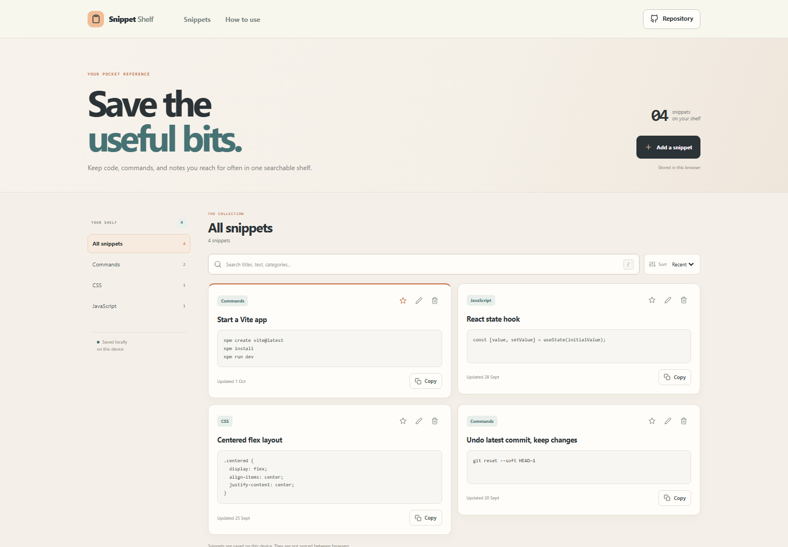

# Clipboard Snippet Library

Snippet Shelf keeps small pieces of reusable text in a searchable browser library. This app is included in the [React Mini Projects](https://github.com/a2rp/react_mini_projects) collection and is available at `/apps/clipboard-snippet-library`.

## What you can do

- Start with four example snippets, then add your own.
- Search snippet titles, text, and categories as you type.
- Filter by category and sort by recent update or name.
- Add and edit a title, category, and text in the snippet editor.
- Pin useful snippets, copy them, or delete them after confirmation.
- Press `/` to focus search; press Escape to close an open dialog.
- Use the responsive library on desktop and mobile.

## Saving and privacy

Snippets are stored in this browser's `localStorage` under `snippet-shelf-v1`. They stay on this browser and device, are not synchronized, and are not encrypted. Do not save passwords, API keys, or other secrets. If browser storage is blocked, the app still works for the current tab but changes will not persist after leaving it.

## Run locally

From the repository root, install dependencies and start the Vite server:

```sh
npm install
npm run dev
```

Open `/apps/clipboard-snippet-library` in the running app. Run `npm test`, `npm run lint`, and `npm run build` from the root for checks. Run `npm run deploy` from the root to publish the collection.

## Source

The app source is in [`src/pages/apps/clipboardSnippetLibrary`](https://github.com/a2rp/react_mini_projects/tree/main/src/pages/apps/clipboardSnippetLibrary).
