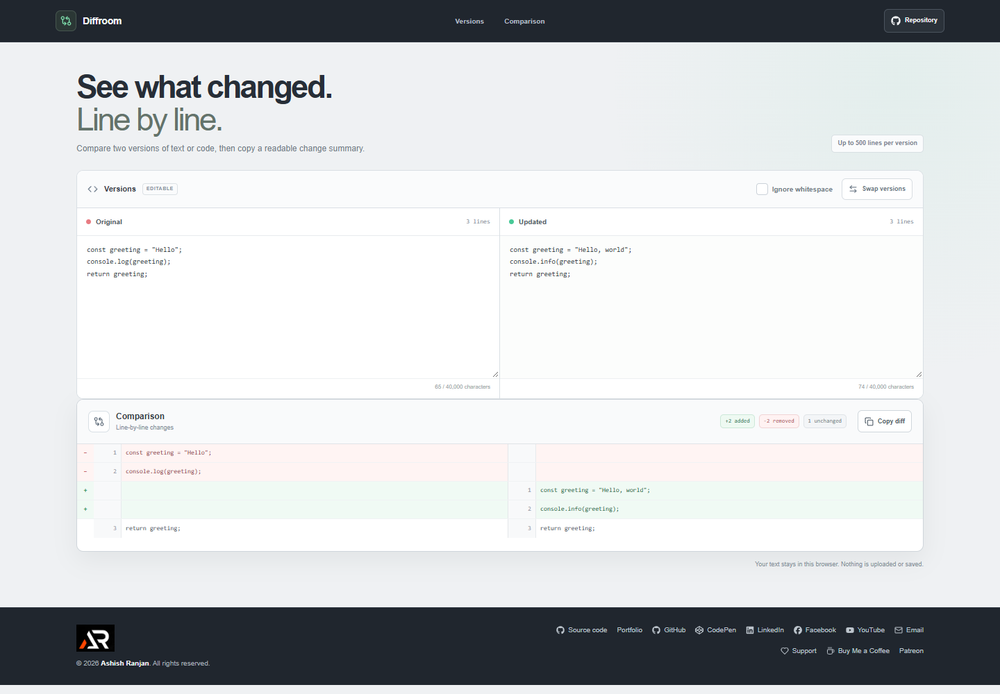



# Code Diff Viewer

Diffroom compares two versions of text or code and shows which lines were added, removed, or left unchanged. It is available at `/apps/code-diff-viewer` in the [React Mini Projects](https://github.com/a2rp/react_mini_projects) collection.

## What is included

- Editable **Original** and **Updated** text panels with character and line counts.
- A line-by-line comparison that marks added, removed, and unchanged lines.
- Change totals, whitespace comparison, swap versions, and copyable diff text.
- A responsive header, source link, profile/support footer, and back-to-top control.

## How the comparison works

The line-based comparison uses a longest common subsequence pass. Each version is limited to 40,000 characters and 500 lines. A final newline is treated as a line ending, not as an extra blank line. This tool compares lines only; it does not create a Git patch with file metadata, syntax highlighting, or word-level changes.

## Privacy

The comparison runs in the browser. Text is not uploaded or saved to local storage. Refreshing restores the example. Clipboard access requires a supported browser context.

## Run locally

From the repository root, install dependencies and start the Vite development server:

```sh
npm install
npm run dev
```

Open `/apps/code-diff-viewer`. Run `npm run lint`, `npm test`, and `npm run build` from the root for checks. Run `npm run deploy` from the root to publish the collection.

## Source

The app source is in [`src/pages/apps/codeDiffViewer`](https://github.com/a2rp/react_mini_projects/tree/main/src/pages/apps/codeDiffViewer).
