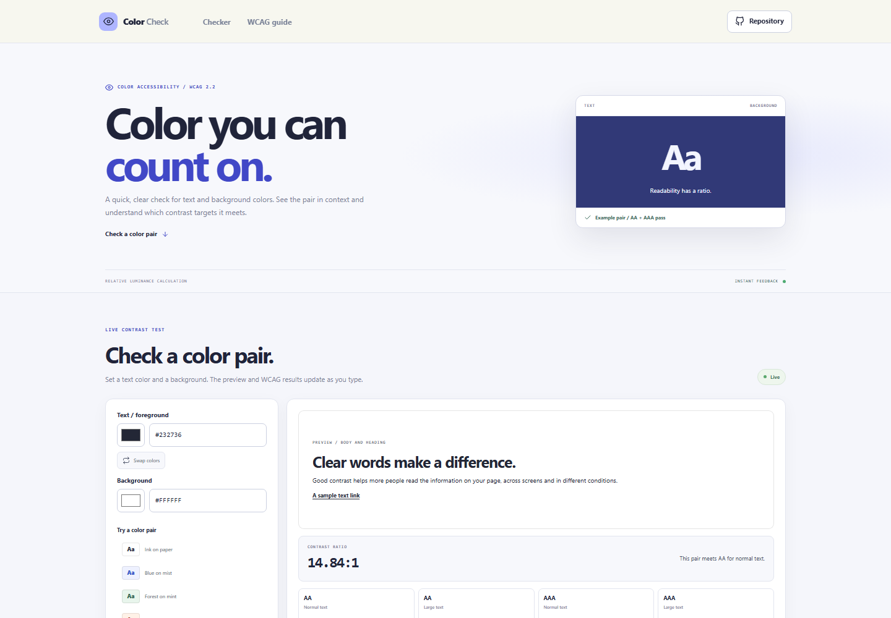



# Color Contrast Checker

Check a foreground and background color pair against WCAG text contrast targets. Edit a hex value or use the native color picker, preview the result, and see AA and AAA levels update as you work. The app is available at `/apps/color-contrast-checker` in the [React Mini Projects](https://github.com/a2rp/react_mini_projects) collection.

## What you can do

- Choose colors with the browser color picker or enter 3- or 6-digit hex values.
- Preview a heading, body paragraph, and link using the selected pair.
- See the contrast ratio update immediately when both colors are valid.
- Swap foreground and background colors and try the example pairs.
- Check WCAG AA and AAA results for normal and large text.

## How the score works

The checker converts each sRGB color to relative luminance and applies the WCAG contrast ratio formula. Results range from 1:1 to 21:1. The tool reports AA normal text at 4.5:1, AA large text at 3:1, AAA normal text at 7:1, and AAA large text at 4.5:1. Large text means at least 18pt regular or 14pt bold. A passing color ratio is one part of accessible design and does not check every accessibility requirement.

## Privacy

Color calculations run locally. The app does not upload or save color choices. Invalid values pause the ratio calculation until corrected.

## Run locally

From the repository root, install dependencies and start the Vite server:

```sh
npm install
npm run dev
```

Open `/apps/color-contrast-checker`. Run `npm test`, `npm run lint`, and `npm run build` from the root for checks. Run `npm run deploy` from the root to publish the collection.

## Source

The app source is in [`src/pages/apps/colorContrastChecker`](https://github.com/a2rp/react_mini_projects/tree/main/src/pages/apps/colorContrastChecker).
