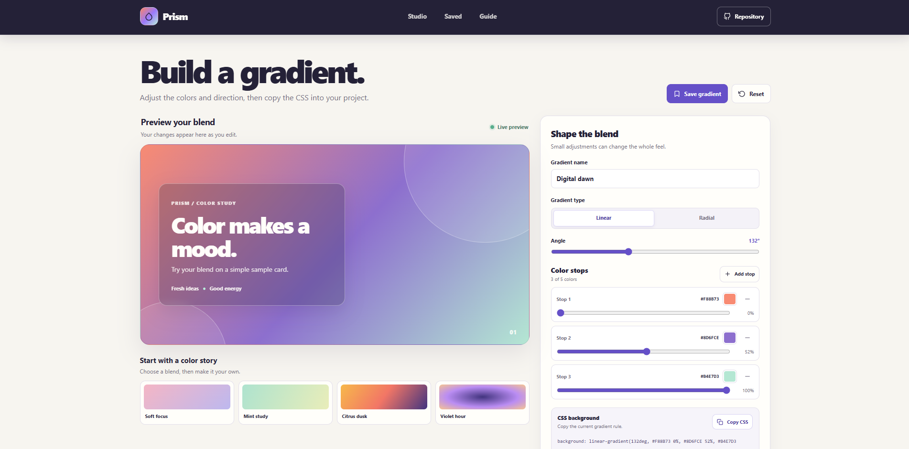



# Color Gradient Explorer

Create linear or radial CSS gradients, adjust their color stops, preview the result, and save or copy the CSS. The app is available at `/apps/color-gradient-explorer` in the [React Mini Projects](https://github.com/a2rp/react_mini_projects) collection.

## Features

- Start from a preset or build a gradient from two to five color stops.
- Switch between linear and radial gradients and adjust linear direction.
- Edit stop colors and positions with the native controls.
- Save gradients in this browser, then reload or remove them from the saved list.
- Copy the generated CSS rule for use in another project.

Saved gradients use this browser's local storage and do not sync to other devices.

## Run locally

From the collection root:

```sh
npm install
npm run dev
```

Open `/apps/color-gradient-explorer`. Run `npm test`, `npm run lint`, and `npm run build` from the root to check the collection.

## Source

The app source is in [`src/pages/apps/colorGradientExplorer`](https://github.com/a2rp/react_mini_projects/tree/main/src/pages/apps/colorGradientExplorer).
