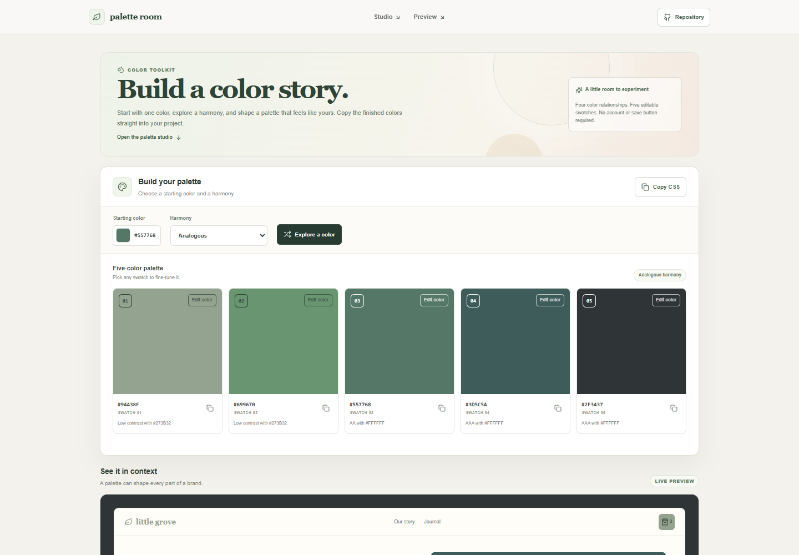

# Color Palette Studio

Explore color relationships, edit a five-color palette, and preview it in a sample storefront. The app is available at `/apps/color-palette-studio` in the [React Mini Projects](https://github.com/a2rp/react_mini_projects) collection.

## Features

- Choose a starting color and explore analogous, complementary, triadic, and split-complementary schemes.
- Edit each of the five generated swatches independently.
- Review contrast guidance for each color.
- Copy individual HEX values or export the full palette as CSS custom properties.
- Preview palette changes in a sample storefront.

Palette changes stay in the current page session and are not saved between visits.

## Run locally

From the collection root:

```sh
npm install
npm run dev
```

Open `/apps/color-palette-studio`. Run `npm test`, `npm run lint`, and `npm run build` from the root to check the collection.

## Source

The app source is in [`src/pages/apps/colorPaletteStudio`](https://github.com/a2rp/react_mini_projects/tree/main/src/pages/apps/colorPaletteStudio).
