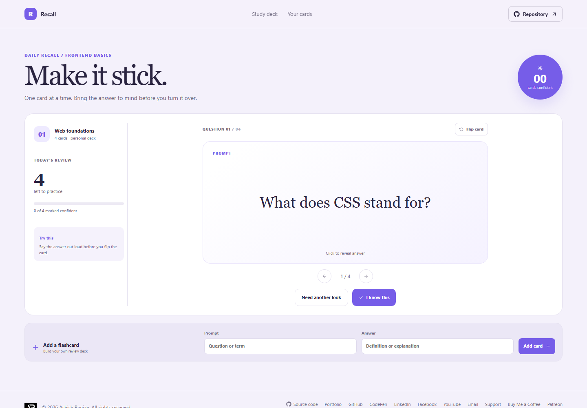

# Recall

Recall is a small active-recall workspace for practicing a deck of question and answer cards.

**Collection route:** `/apps/flashcard-study-tool`  
**Collection source:** [React Mini Projects](https://github.com/a2rp/react_mini_projects/tree/main/src/pages/apps/flashcardStudyTool)

## How to use it

Read the prompt, try to remember the answer, then flip the card. Move between cards or mark a card as known. Add new prompts and answers in the form below the deck.

## Features

- Flip a card to reveal its answer
- Previous and next card controls
- Mark cards as known and view deck progress
- Add custom prompt and answer pairs
- Seeded web-development cards for immediate practice

## Data and limits

Cards you add and cards you mark as known are stored in this browser with localStorage. If browser storage is unavailable, the deck still works for the current page session and the app displays a notice.

The app currently uses one deck and does not schedule spaced repetition or share cards with another device.

## Run locally

Use Node.js 20.19 or newer in the 20.x line, or 22.12 or newer, then run these commands from the project folder:

    npm install
    npm run dev

## Checks and deployment

    npm run lint
    npm run build
    npm run deploy

The deploy command builds the site and publishes the contents of dist to the gh-pages branch. The project is configured for GitHub Pages at https://a2rp.github.io/flashcard-study-tool/.

## Future improvements

These are ideas only and are not implemented yet:

- Create and rename multiple decks (idea, not implemented)
- Add due dates with a spaced-repetition schedule (idea, not implemented)
- Import and export card sets (idea, not implemented)

## Links

- Portfolio: [https://www.ashishranjan.net](https://www.ashishranjan.net)
- GitHub: [https://github.com/a2rp](https://github.com/a2rp)
- CodePen: [https://codepen.io/ash1198](https://codepen.io/ash1198)
- LinkedIn: [https://www.linkedin.com/in/aashishranjan](https://www.linkedin.com/in/aashishranjan)
- Facebook: [https://www.facebook.com/theash.ashish/](https://www.facebook.com/theash.ashish/)
- YouTube: [https://www.youtube.com/@ashishranjan-ashz?sub_confirmation=1](https://www.youtube.com/@ashishranjan-ashz?sub_confirmation=1)
- Email: [mailto:ash.ranjan09@gmail.com](mailto:ash.ranjan09@gmail.com)

## Support

- Support: [https://a2rp-donation-page.netlify.app/](https://a2rp-donation-page.netlify.app/)
- Buy Me a Coffee: [https://buymeacoffee.com/ashishranjan](https://buymeacoffee.com/ashishranjan)
- Patreon: [https://www.patreon.com/ashishranjan](https://www.patreon.com/ashishranjan)
