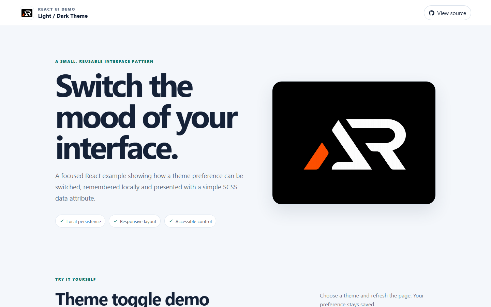

# Light Dark Theme Toggle

**Collection source:** [React Mini Projects](https://github.com/a2rp/react_mini_projects/tree/main/src/pages/apps/lightDarkThemeToggle)

A small React interface that switches between light and dark themes and remembers the selected preference in the browser.



## Features

- Light and dark theme switching
- Local preference persistence with browser storage
- Responsive layout with a fixed branding header
- Accessible controls, icon-only social links, and a floating go-to-top button
- SCSS module styling with simple border and shadow interactions

## Tech stack

React, Vite, Sass, SCSS modules, and React Icons. This app runs inside the shared React Mini Projects collection.

## Run locally

From the `react_mini_projects` repository root:

```bash
npm ci
npm run dev
```

Open `/apps/light-dark-theme-toggle` in the local site.
